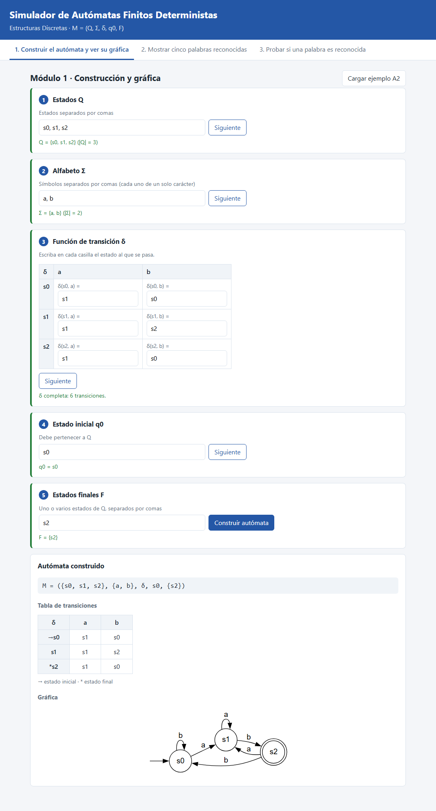
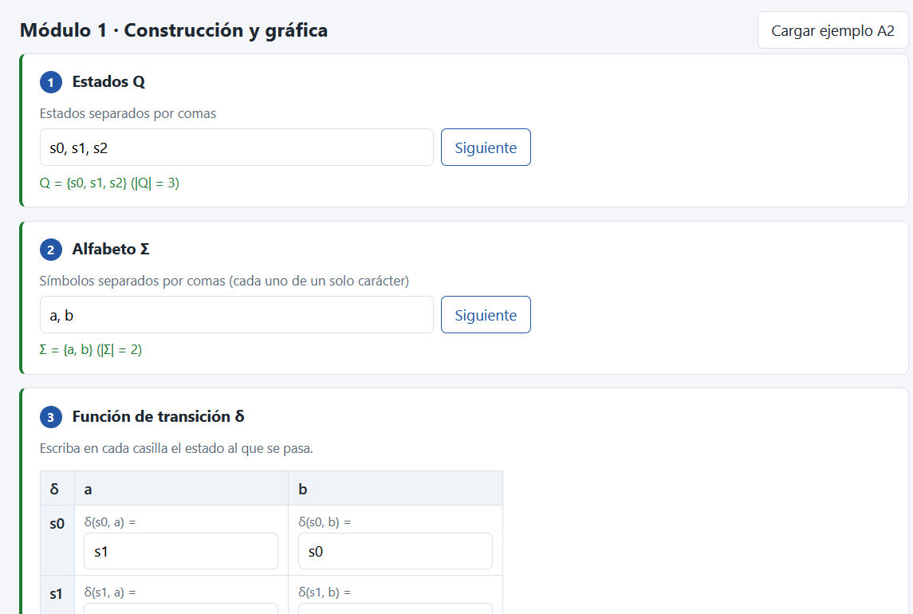
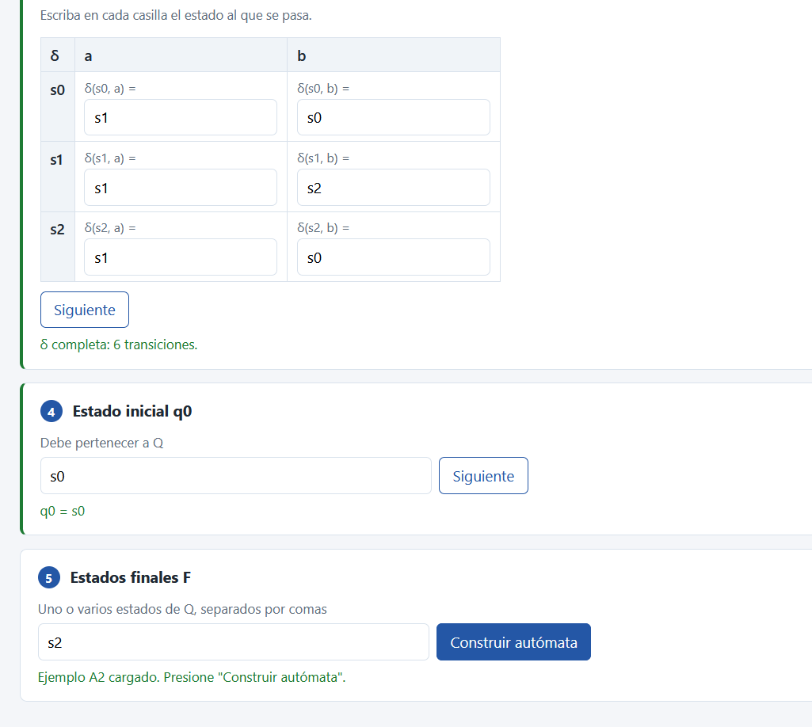
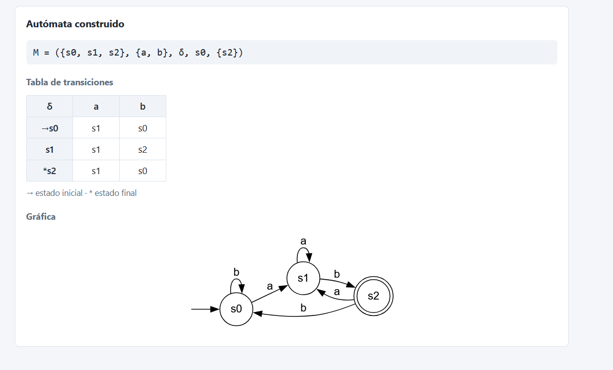
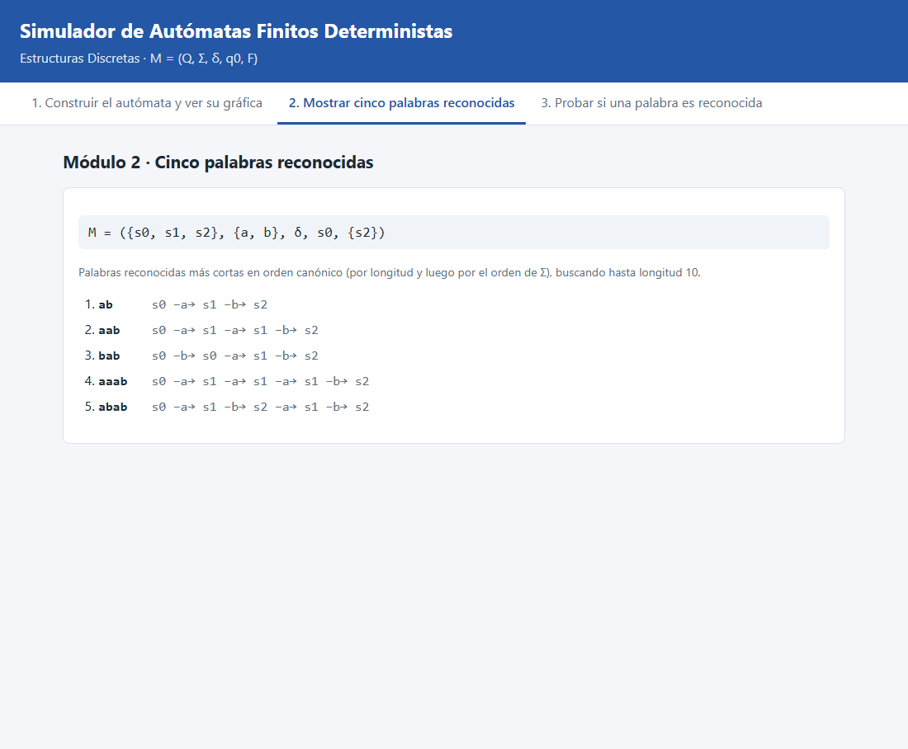
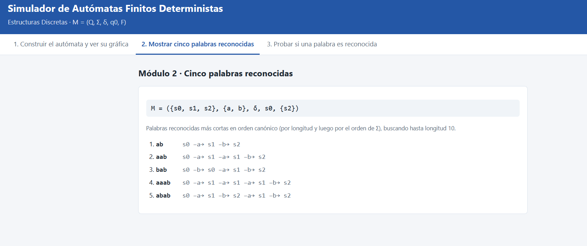
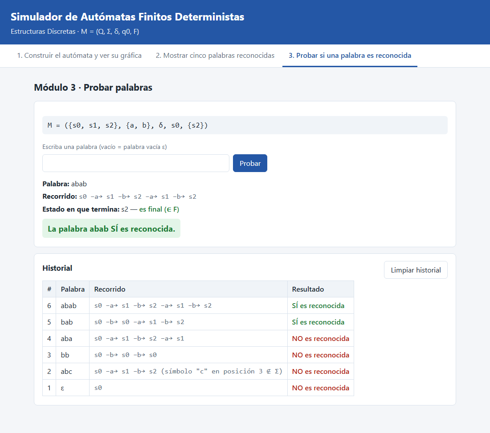
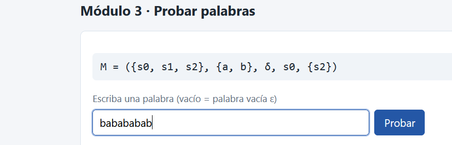
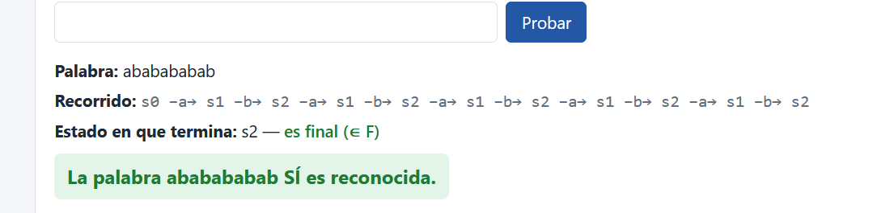
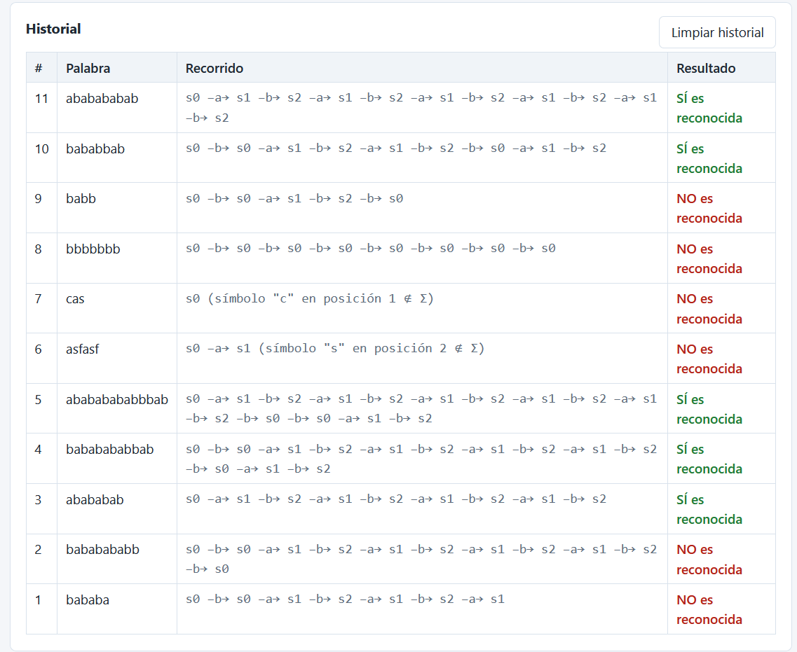

# Simulador de Autómatas Finitos Deterministas (AFD)

Proyecto de la asignatura **Estructuras Discretas**. Página web que permite construir un AFD
M = (Q, Σ, δ, q0, F), ver su tabla de transiciones y su gráfica, listar las cinco palabras
reconocidas más cortas y probar si una palabra es reconocida.

## Integrantes

- Jesús Rueda

## Lenguaje y navegador

- **Lenguaje:** HTML5, CSS3 y JavaScript (ES2017 o posterior), con **jQuery 3.7.1**.
- **Gráficas:** Graphviz en el navegador mediante **Viz.js 3.11.0** (`@viz-js/viz`, Graphviz 12.2.0).
- **Navegador probado:** Microsoft Edge 157 (Chromium), Firefox reciente. También debería funcionar en Chrome recientes.
- No requiere servidor, internet, Node ni npm.

## Cómo ejecutarlo

1. Abrir la carpeta del proyecto.
2. Hacer **doble clic en `index.html`** (se abre con el protocolo `file://`).
3. Para ver las pruebas automáticas, abrir **`pruebas.html`**: cada caso aparece en verde (pasa) o en rojo (falla).

Las librerías están descargadas en `lib/`, así que todo funciona sin conexión a internet.

## Estructura

```
index.html          Página principal (encabezado + 3 módulos)
pruebas.html        Casos de prueba A1–A4
css/estilos.css     Estilos
js/automata.js      Lógica del AFD (sin jQuery): validaciones, recorrido, búsqueda canónica
js/grafica.js       Generación del código DOT y dibujo con Viz.js
js/modulo1.js       Módulo 1: construcción paso a paso, tabla y gráfica
js/modulo2.js       Módulo 2: cinco palabras reconocidas
js/modulo3.js       Módulo 3: probar palabras e historial
js/ui.js            Navegación entre módulos y autómata actual
lib/                jQuery y Viz.js
```

### Representación del autómata

| Componente | Estructura en JavaScript | Motivo |
|---|---|---|
| Q | arreglo `string[]` | conserva el orden de ingreso (tabla y gráfica) |
| Σ | arreglo `string[]` | su orden define el orden canónico y las etiquetas `a, b` |
| δ | `Map<estado, Map<símbolo, estado>>` | `delta.get(q).get(a)` se lee como δ(q, a) |
| q0 | `string` | un solo estado |
| F | `Set<string>` | preguntar "¿es final?" es `finales.has(q)` |

## Ejemplo de uso con A2 (palabras sobre {a, b} que terminan en `ab`)

**Módulo 1.** Presionar **"Cargar ejemplo A2"** (o escribirlo a mano):

| Paso | Valor |
|---|---|
| Q | `s0, s1, s2` |
| Σ | `a, b` |
| δ | δ(s0,a)=s1, δ(s0,b)=s0, δ(s1,a)=s1, δ(s1,b)=s2, δ(s2,a)=s1, δ(s2,b)=s0 |
| q0 | `s0` |
| F | `s2` |

Al presionar **"Construir autómata"** se muestra:

```
M = ({s0, s1, s2}, {a, b}, δ, s0, {s2})
```

| δ | a | b |
|---|---|---|
| →s0 | s1 | s0 |
| s1 | s1 | s2 |
| *s2 | s1 | s0 |

y la gráfica (flecha de entrada a s0, s2 con doble círculo, bucles en s0 y s1).

**Módulo 2.** Muestra: `ab`, `aab`, `bab`, `aaab`, `abab`, cada una con su recorrido,
por ejemplo `ab: s0 –a→ s1 –b→ s2`.

**Módulo 3.** Escribir `abab` y presionar **Probar** (o Enter):
recorrido `s0 –a→ s1 –b→ s2 –a→ s1 –b→ s2`, termina en `s2` (final) → **SÍ es reconocida**.
Con `abc`: **NO es reconocida**, el símbolo "c" (posición 3) no pertenece a Σ = {a, b}.

## Librerías utilizadas (fuentes)

- **jQuery 3.7.1** — OpenJS Foundation, licencia MIT. https://jquery.com/ (archivo `lib/jquery-3.7.1.min.js`, descargado de https://code.jquery.com/jquery-3.7.1.min.js).
- **Viz.js 3.11.0** (`@viz-js/viz`) — Michael Daines, licencia MIT; incluye Graphviz 12.2.0 compilado a WebAssembly. https://github.com/mdaines/viz-js (archivo `lib/viz-standalone.js`, descargado de https://cdn.jsdelivr.net/npm/@viz-js/viz@3.11.0/lib/viz-standalone.js).
- **Graphviz** — https://graphviz.org/

Ninguna librería implementa autómatas: toda la lógica del AFD está en `js/automata.js`.
Viz.js solo convierte en imagen el texto DOT que genera el programa.

## Uso de inteligencia artificial

Se utilizó **Claude Code** (asistente de programación de Anthropic) para:

- escribir comentarios del codigo fuente en español;
- redactar este README.

## Capturas

Todas las capturas usan el autómata **A2** (palabras sobre {a, b} que terminan en `ab`).

### Módulo 1 · Construcción y gráfica

Los cinco pasos validados, la 5-tupla, la tabla de transiciones y la gráfica.



#### Capturas adicionales del Módulo 1

Pasos 1 a 3 del asistente: Q y Σ validados y la tabla para ingresar δ.



Pasos 3 a 5: δ completa, q0 = s0 y F = {s2}, listo para construir.



Autómata construido: 5-tupla, tabla de transiciones y gráfica.



### Módulo 2 · Cinco palabras reconocidas

Las cinco palabras reconocidas más cortas en orden canónico, con su recorrido.



#### Capturas adicionales del Módulo 2



### Módulo 3 · Probar palabras

Casos del enunciado: ε (no reconocida), `abc` (símbolo "c" en posición 3 ∉ Σ), `bb`, `aba`, `bab` y `abab`.



#### Pruebas adicionales del Módulo 3

Palabras más largas y símbolos fuera del alfabeto.






